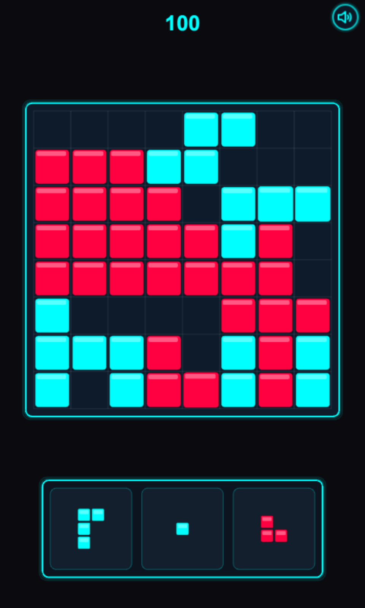

# Based Blocks

A standalone block puzzle built with Phaser 3.90 and Vite. Place shapes on an 8 × 8 board, clear rows and columns, and build combos. Includes two neon themes, sound effects, music, daily check-ins, and personal records.

<p align="center">
  
</p>

## Play locally

Use Node.js 22.12 or newer.

```sh
npm ci
npm run dev
```

Open the local URL printed by Vite. All game assets, including the font, are included. Once the local server is running, playing requires no internet connection.

Drag one of the three shapes onto the board. Fill a row or column to clear it. The game ends when none of the remaining shapes fits. Use the sound button to mute audio and the menu to switch themes.

## Privacy

Scores, settings, daily check-ins, and your five best games are saved only in this browser's local storage. Clearing the site's browser data resets them. The game has no accounts, external database, wallet, blockchain client, analytics, or remote API. No environment variables or credentials are needed.

The page's content security policy limits asset loading and connections to the same origin. A publication check and an offline check prevent external service code or credentials from being added accidentally.

## Development

```sh
npm run test:run
npm run check:publication
npm run check:offline
npm run build
npm run preview
```

`dist/` is the static build output. It can be served by a local HTTP server or a static web host. Dependencies are installed during development; npm's registry URLs in the lockfile are not game connections.

`src/core/` contains board rules and scoring, `src/scenes/` and `src/presentation/` contain the interface, and `src/data/` manages device-only progress and audio. The bundled Orbitron font is distributed under the license in `public/assets/fonts/OFL.txt`.
